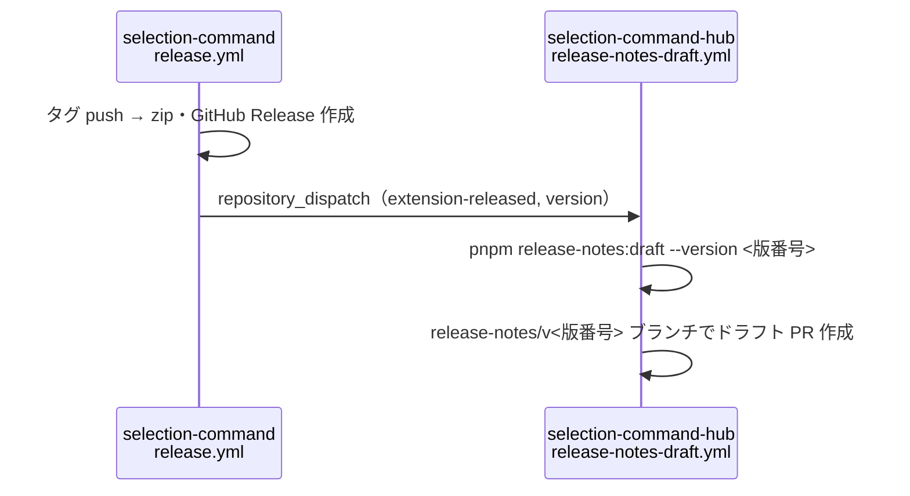

# リリースノートの自動生成

> 本書は AI（Claude Code）による記載。対応 Issue: #576

## 1. 概要

リリースタグ（`v<版番号>`）を push すると、前回のタグからの変更をもとに次の 2 つを自動で作る。

| 出力                           | 作成場所                            | 生成方法                                               |
| ------------------------------ | ----------------------------------- | ------------------------------------------------------ |
| GitHub Release の本文          | このリポジトリ（`release.yml`）     | git-cliff（コミットログ）                              |
| アップデート情報ページの下書き | selection-command-hub のドラフト PR | Hub の `pnpm release-notes:draft`（PR タイトル・本文） |

どちらも Conventional Commits の種別で分類するため、コミットメッセージと PR タイトルを規約に揃える。

## 2. 規約のチェック

| 対象               | 仕組み                                               | 違反時                 |
| ------------------ | ---------------------------------------------------- | ---------------------- |
| コミットメッセージ | husky の `commit-msg` フック + commitlint            | 警告のみ（コミット可） |
| PR タイトル        | `.github/workflows/pr-title.yml`（semantic PR 検査） | チェックが失敗する     |

- 設定: `commitlint.config.mjs`（`@commitlint/config-conventional` を基本に、日本語の件名を許可）
- 使える種別: `feat` `fix` `perf` `refactor` `revert` `docs` `style` `test` `build` `ci` `chore`
- バージョン更新のコミットは `chore(release): v<版番号>` とする
- `dev-*` ブランチ（リリースのまとめ PR）は PR タイトルを検査しない。リリースノートでも除外される
- フックは `yarn install` 時に `prepare`（`husky`）で有効になる

## 3. GitHub Release の本文（git-cliff）

- 設定: `cliff.toml`
- 範囲: 直前のタグ〜今回のタグ（`--latest`）
- 対象: `packages/extension/` `packages/shared/` を変更したコミット
- 分類

| 種別       | 見出し      |
| ---------- | ----------- |
| `feat`     | Features    |
| `fix`      | Bug Fixes   |
| `perf`     | Performance |
| `refactor` | Refactoring |
| `revert`   | Reverts     |

- 上記以外の種別、マージコミット、`chore(release)`、規約に沿わないコミットは載せない
- PR 内のレビュー対応コミット（件名が `<種別>(<スコープ>): address ... review ...` の形）は載せない
- タグ名が `v` で始まらない push ではワークフロー自体が動かない
- ノート生成に失敗しても Release は作成する（本文は空になり、警告を出す）。PR リンクの付与に失敗した場合は短縮 SHA のまま公開する
- 各行に、そのコミットを取り込んだ PR へのリンクを付ける（取得できない場合は短縮 SHA）
  - git-cliff は各行を短縮 SHA で出力し、`.github/scripts/link-release-note-prs.sh` が GitHub API（`/commits/<sha>/pulls`）で PR を調べて置き換える
  - 機能 PR → `dev-*` をマージコミットで取り込む運用のため、git-cliff 単体では PR 番号を取得できない。`dev-*` の PR は除外し、機能 PR を採用する
  - 1 つの PR に複数のコミットがあれば、同じ PR 番号が複数行に付く
  - API 呼び出しは 1 リリースあたりコミット数ぶん（数十回）で、`GITHUB_TOKEN` の上限内に収まる
- ローカルでの確認（前回のタグ以降の未リリース分を `RELEASE_NOTES.md` に出力して表示する。ファイルは git 管理外）

```bash
yarn release-notes
```

## 4. Hub のアップデート情報ドラフト



- 生成ロジックと分類ルールは Hub 側に一本化している（詳細は Hub の `docs/108_whats-new-page.md`）
- このリポジトリは通知だけを行う

## 5. 必要な設定

| 場所                  | 設定                                                                                                   |
| --------------------- | ------------------------------------------------------------------------------------------------------ |
| このリポジトリ        | secret `HUB_DISPATCH_TOKEN`: selection-command-hub の Contents: Read and write を持つ fine-grained PAT |
| selection-command-hub | Settings → Actions → General →「Allow GitHub Actions to create and approve pull requests」を有効化     |

- `HUB_DISPATCH_TOKEN` が未設定の場合、通知はスキップされる（警告のみでリリースは成功する）

## 6. 運用上の注意

- 起点はタグの push。タグを作らないリリースがあると、次回の範囲がずれる（直前の**存在する**タグから差分を取る）
